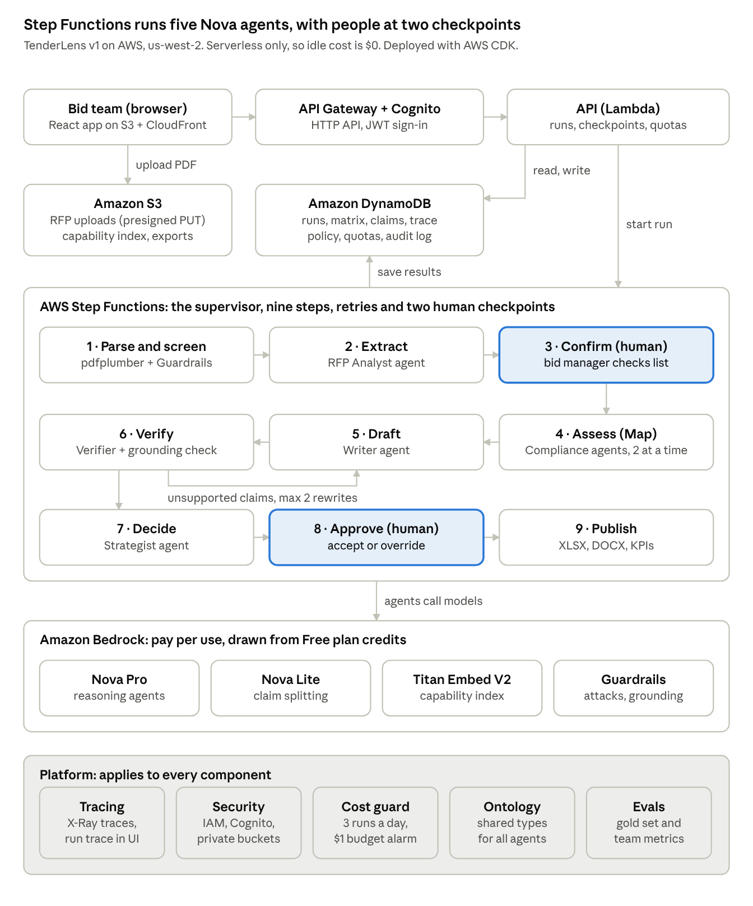

# TenderLens

TenderLens is an RFP response and compliance agent. It reads a request for proposal, extracts every mandatory requirement, maps each one to evidence in a company's capability documents, drafts a cited response, flags the claims nobody can back up, and recommends whether to bid.

Five specialist agents, built with LangGraph on Amazon Nova, do the reading, judging and writing. AWS Step Functions orchestrates them, with two human checkpoints. Everything is serverless on AWS, so the stack costs nothing while idle.

> Status: v1, October 2026. The full workflow, the web app and the AWS stack are built; evals against Amazon Nova come next.

## The problem

Companies lose bids because answering long RFPs is slow, requirements get missed, and proposal claims aren't backed by evidence.

## What a run produces

Upload an RFP PDF and TenderLens returns:

1. **A requirements checklist**: every requirement as a verbatim quote, with page, category, and whether it is mandatory or pass/fail critical.
2. **A compliance matrix**: Met, Partial, Not met or No evidence for each requirement, linked to the exact passage and page that proves it.
3. **A gap register**: what the company can't meet, with a suggested mitigation for each.
4. **A cited draft response**: written in the RFP's own section order, where every factual sentence cites its evidence.
5. **Unsupported claims**: every claim is checked against its evidence, and weak ones are rewritten or flagged.
6. **A bid/no-bid recommendation**: knock-out rules first, then a score weighted by the RFP's own evaluation criteria, approved or overridden by a person.

## Architecture



- The browser uploads the RFP to S3, and the API starts one Step Functions run.
- Step Functions runs nine steps. Five of them call agents on Amazon Nova, and two wait for a person.
- The Verifier can send unsupported claims back to the Writer, at most twice.
- Results and the per-agent trace land in DynamoDB, and the React app reads them from there.

Full design: [Product requirements](docs/PRD.md) and [High-level design](docs/HLD.md).

## Agentic AI capabilities

| Capability | How TenderLens does it |
| --- | --- |
| Multi-agent | Five specialist agents (RFP Analyst, Compliance Analyst, Proposal Writer, Claim Verifier, Bid Strategist), each with its own prompt, tools and model |
| Multi-step workflow and orchestration | Step Functions is the deterministic supervisor: retries, a Map fan-out, a rewrite loop and visual run history |
| Tool calling | Agents choose their own tools: evidence search, section lookup, a shall/must scanner, scoring and a grounding check |
| Agent-to-agent communication | Typed messages defined by the ontology, passed between agents through S3 (blackboard pattern) |
| Human in the loop | Confirm the extracted requirements; approve or override the bid decision (Step Functions task tokens) |
| Guardrails | Bedrock Guardrails prompt-attack filter on RFP text, contextual grounding check on every claim, schema validation on every agent output |
| Tracing and observability | Every agent step, tool call, token count, cost and latency per run, plus X-Ray traces and structured logs |
| Evals | A hand-labelled gold set measuring extraction recall, critical recall, status accuracy and citation validity, plus team-level orchestration metrics |
| Governance | Cognito sign-in, least-privilege IAM, a daily run cap, token budgets per run, budget alarms and a live-run switch |
| Ontology | One schema for every entity the agents exchange; it drives tool schemas, retrieval filters and the evidence trail |

## Tech stack

| Layer | Choice |
| --- | --- |
| Agents | LangGraph / LangChain on `ChatBedrockConverse` |
| Models | Amazon Nova Pro and Nova Lite, Titan Text Embeddings V2 (Amazon Bedrock) |
| Orchestration | AWS Step Functions (Standard) |
| Compute and API | AWS Lambda (Python 3.12, Powertools), API Gateway HTTP API |
| Data | DynamoDB (single table), S3 |
| Safety | Bedrock Guardrails, Pydantic schema validation |
| Auth | Amazon Cognito |
| Web | React + TypeScript (Vite), S3 + CloudFront |
| Infrastructure | AWS CDK (Python) |

## Repository layout

```text
backend/    Python package: ontology, agents, tools, retrieval, pipeline handlers, API
infra/      AWS CDK app
web/        React + Vite app
evals/      gold labels, eval harness, reports
data/       fictional bidder library and bid policy (RFPs are downloaded, not committed)
scripts/    helper scripts, such as fetch_rfps.py
docs/       PRD, HLD and diagrams
```

## Demo data

- **RFPs:** two public municipal IT-services RFPs, from the [City of Belle Isle, FL](https://www.belleislefl.gov/sites/default/files/fileattachments/finance/page/10736/rfp_2026-04_information_technology_services_final.pdf) and the [City of Dawsonville, GA](https://dawsonville-ga.gov/sites/default/files/fileattachments/city_clerk/page/10387/25-rfp-001_it_managed_services_final.pdf). They aren't stored in this repo; `python scripts/fetch_rfps.py` downloads them from the official sites.
- **Bidder:** Cobalt Harbor IT Services is **fictional**. Its capability documents were written for this project, with deliberate gaps so the agents have real findings to make.

## Cost

TenderLens uses only serverless, pay-per-use services: no clusters, load balancers or NAT gateways. Idle cost is $0. Live runs are capped per day and per run, and a single parameter switches live runs off while past runs stay viewable.

## Getting started

You need Python 3.12 with [uv](https://docs.astral.sh/uv/), Node.js 20+ with pnpm, and the demo RFPs:

```bash
python scripts/fetch_rfps.py
```

### Run it locally, no AWS needed

The local API runs the same nine steps, with the same two human checkpoints, in-process. `--stub` swaps the models for scripted offline agents, so the whole flow works without credentials.

```bash
cd backend && uv run python -m tenderlens.api.devserver --stub
```

```bash
cd web && pnpm install && pnpm dev
```

Open http://localhost:5173 and upload an RFP. To use real Amazon Nova models while keeping storage local, drop `--stub` and set `TL_AWS_PROFILE` to an AWS CLI profile with Bedrock access.

### Deploy to AWS

You need the AWS CLI with a configured profile, Docker running (CDK builds the Lambda layer in a container), and Bedrock access to Amazon Nova and Titan Text Embeddings V2 in `ap-southeast-2` (Sydney). Nova calls go through the APAC cross-region inference profiles. To deploy elsewhere, set `AWS_REGION` and the `TL_MODEL_PRO` / `TL_MODEL_LITE` profile IDs for that region.

```bash
scripts/deploy.sh tenderlens
```

The script builds the evidence index with Titan embeddings, builds the web app, bootstraps CDK and deploys the stack, then prints the web URL. Then create logins (self sign-up is off):

```bash
scripts/create_user.sh person@example.com tenderlens
```

Turn live runs off when you don't need them. Past runs stay viewable, and the stack then costs nothing:

```bash
scripts/live_runs.sh off tenderlens
```

### Tests and evals

```bash
cd backend && uv run pytest
```

Unit and end-to-end tests run offline with the stub models. The eval harness scores a real run against the hand-labelled Belle Isle gold set, and calls the models, so run it on demand:

```bash
cd backend && uv run python ../evals/run_eval.py --pdf ../data/rfps/belle-isle-rfp-2026-04.pdf
```

## License

[MIT](LICENSE)
