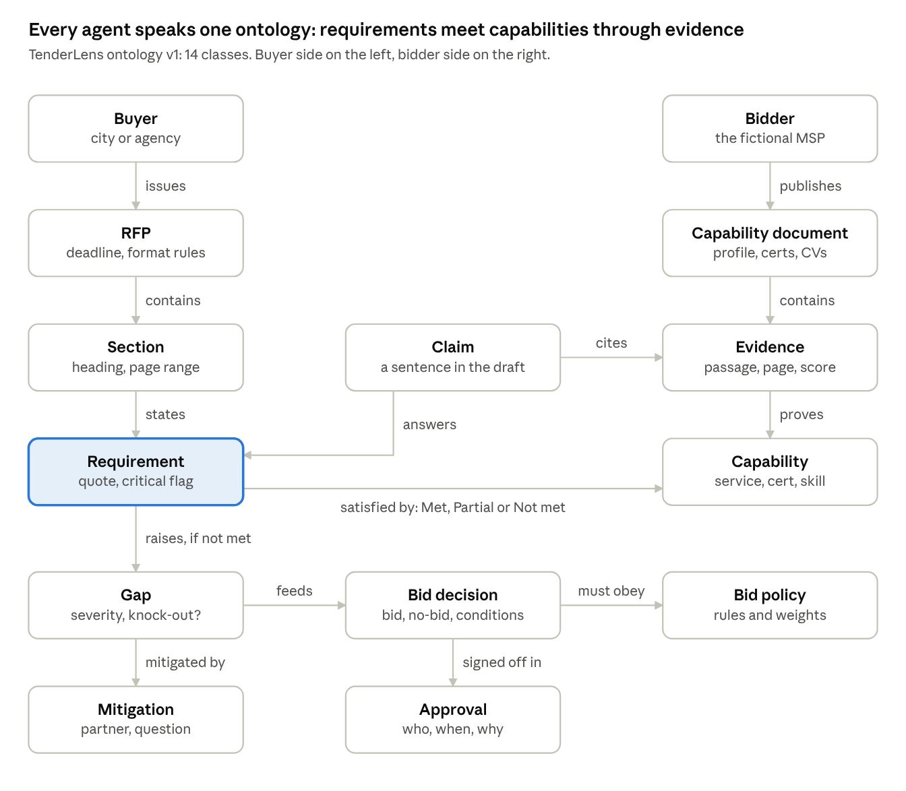

# TenderLens — High-level design

## Architecture

1. The browser uploads the RFP straight to S3, and the API starts one Step Functions run, after checking the daily cap.
2. Step Functions runs nine steps. Five of them call Nova agents, and two wait for a person.
3. The Verifier can send claims back to the Writer, at most twice.
4. Results and the trace land in DynamoDB, and the web app reads them from there.

## Agentic capability coverage

Every capability is in v1, each in the simplest form that runs at $0 idle cost.

| Capability | How TenderLens v1 does it | AWS service |
| --- | --- | --- |
| Multi-agent | Five specialist agents (Analyst, Compliance, Writer, Verifier, Strategist), each with its own prompt, tools and model | LangGraph agents in Lambda, Amazon Nova |
| Multi-step workflow | Nine steps with retries, a Map fan-out and a rewrite loop | Step Functions Standard |
| Multi-agent orchestration | Step Functions is the deterministic supervisor and decides who works next. Each agent decides how: which tool to call, and when to search again. | Step Functions |
| Agent-to-agent communication | Typed messages defined by the ontology, written to S3 and passed by reference to the next agent (a blackboard pattern) | S3, Step Functions |
| Tool calling | Agents call Python tools through Nova's tool use, such as search_evidence, get_section, scan_modal_verbs and compute_score | Bedrock Converse API |
| Human in the loop | Confirm the requirements after extraction; approve or override the bid decision | Step Functions task tokens |
| Guardrails | A prompt-attack filter on RFP text, a contextual grounding check on every claim, and schema validation of every agent output | Bedrock Guardrails |
| Tracing and observability | Each run records every agent step, tool call, token count, cost and latency in a Trace tab, plus X-Ray traces and structured logs | Powertools, X-Ray, CloudWatch |
| Evals | Gold set: extraction recall, critical recall, status accuracy, citation validity, evidence-backed rate | Python harness, on demand |
| Multi-agent orchestration evaluation | Team-level metrics from the trace: task completion, hand-off validity, rewrite rounds, redundant tool calls, cost and latency per agent | Same harness |
| Governance: cost | A daily live-run cap, a token budget per run, budget alarms, and a live-run switch | AWS Budgets, DynamoDB, SSM Parameter Store |
| Governance: security | Cognito sign-in with no self sign-up, JWT check, least-privilege IAM per Lambda, private buckets, audit log | Cognito, IAM, S3, DynamoDB |
| Ontology | One schema for every entity the agents exchange. It drives the tool schemas, retrieval filters and the evidence trail. | Pydantic + YAML, in code |

## Components and tech choices

Every piece is serverless, so nothing costs money while idle, and one CDK command deploys or tears down the whole stack.

| Layer | Choice | Why | Alternative considered |
| --- | --- | --- | --- |
| Web app | React + TypeScript (Vite), hosted on S3 + CloudFront | Looks like a product and costs nothing at demo traffic | Streamlit: faster, but reads as a prototype |
| Sign-in | Cognito user pool, admin-created users only | Managed login, and API Gateway checks its JWTs natively | A shared password: no audit trail |
| API | API Gateway HTTP API + Lambda (Python 3.12, Powertools) | Pay per request, no idle servers | FastAPI on ECS: idle cost |
| Orchestration | Step Functions Standard | A supervisor with retries, Map, loops, task-token checkpoints and visual run history | One LangGraph supervisor graph for the whole run: everything in one process, with no durable checkpoints across days |
| Agents | LangGraph agents (LangChain `create_agent` on `ChatBedrockConverse`), one per Lambda | The tool-calling loop is an explicit state graph, with structured output and token metrics through callbacks. The same graphs can later run on AgentCore. | Strands Agents or Bedrock Agents (classic): less control, harder to test locally |
| Models | Nova Pro for the reasoning agents, Nova Lite for claim checks, through the Converse API | Low cost; a 300K-token context fits a whole RFP | Claude on Bedrock: stronger, one config change away |
| Retrieval | Titan Text Embeddings V2 + BM25 keyword search, over an index file in S3 searched inside Lambda | About 40 pages of bidder documents fit in memory, at $0 idle | Bedrock Knowledge Bases or OpenSearch: more setup or idle cost |
| Parsing | pdfplumber | Free, keeps page numbers, handles text-based PDFs | Textract: for scanned PDFs, in the upgrade path |
| Safety | Bedrock Guardrails + Pydantic schema validation | Checks enforced outside the prompt | Prompt instructions alone |
| Storage | DynamoDB on-demand (single table) + S3 | $0 idle | RDS: idle cost |
| Observability | Powertools logs, traces and metrics, X-Ray, CloudWatch, plus the app's Trace tab | One run ID ties everything together | Third-party APM |
| Delivery | AWS CDK (Python); GitHub Actions runs the tests | Repeatable infrastructure without extra setup | Terraform |

## Workflow and the agent team

Step Functions runs nine steps and decides who works next. Each agent decides how to do its job: which tool to call, and when to search again.

**Workflow (Step Functions):**

1. **Parse and screen.** pdfplumber extracts page-tagged text and tables, and Guardrails screens the text for prompt attacks.
2. **Extract.** The RFP Analyst agent returns the requirements.
3. **Confirm (human).** The bid manager checks the list and corrects types or criticality. In demo mode this step auto-continues after 2 minutes.
4. **Assess.** A Map state runs Compliance agents on batches of requirements, two batches at a time, to stay within Bedrock quotas.
5. **Draft.** The Writer agent drafts each response section with citations.
6. **Verify.** The Verifier agent checks every claim. If any are unsupported, the run loops back to Draft, at most twice.
7. **Decide.** The Strategist agent applies the knock-outs, scores the bid and writes the rationale.
8. **Approve (human).** The approver accepts the decision or overrides it with a reason. This step times out after 7 days.
9. **Publish.** Writes the XLSX and DOCX, and records the KPIs and cost.

**The agent team (LangGraph agents in Lambda):**

| Agent | Job | Tools | Model | Checks outside the model |
| --- | --- | --- | --- | --- |
| RFP Analyst | Extracts atomic requirements from each section | get_section, scan_modal_verbs | Nova Pro | Each quote must match the source word for word. Scan hits that no requirement covers become "possible misses". |
| Compliance Analyst | Searches the evidence, judges each requirement's status, cites passages | search_evidence (hybrid, filtered by category), get_passage | Nova Pro | At most 3 searches per requirement; cited passages must exist |
| Proposal Writer | Drafts each section in RFP order with [E#] citations, with SME placeholders where a fact is unknown | get_matrix, get_evidence | Nova Pro | Output schema checked |
| Claim Verifier | Splits the draft into claims and checks each against its evidence | split_claims, check_grounding (Guardrails) | Nova Lite | Runs independently of the drafting prompt; at most 2 rewrite rounds |
| Bid Strategist | Applies the knock-outs, scores the bid, writes the rationale | get_bid_policy, compute_score, list_gaps | Nova Pro | The score is computed in code, not by the model |

Every agent has a token budget and a cap on tool calls. Hitting either stops the run with a clear status. Time to first draft excludes the confirm checkpoint, so it measures machine time only.

**Agent-to-agent messages.** Agents never call each other directly. Each agent writes a typed message, defined by the ontology, to S3, and Step Functions passes its key to the next agent (a blackboard pattern). Every message is checked against its schema when it's written and again when it's read.

| Message | From → to | Carries |
| --- | --- | --- |
| RequirementSet | Analyst → Compliance, after the human confirms | Requirements with quote, page, category and critical flag |
| AssessmentBatch | Compliance → Writer and Strategist | Status, evidence IDs, rationale and confidence per requirement |
| DraftSection | Writer → Verifier | Section text with citations on every claim |
| ClaimVerdicts | Verifier → Writer (rewrite) or Strategist | Verdict and grounding score per claim |
| BidRecommendation | Strategist → approver | Decision, score breakdown, knock-outs and rationale |

## Domain ontology

One small ontology defines every entity the agents exchange. The five agents, their tools, the search index and the database all share its vocabulary.

- **Schemas.** Each class is a Pydantic model, kept in sync with one versioned YAML file by a test. Agent outputs and tool inputs use these models, so a malformed hand-off fails immediately.
- **Taxonomy.** Requirements fall into seven fixed categories: technical services, security and compliance, staffing, service levels, insurance and legal, commercial, and submission. Capability documents carry the same tags, so the Compliance agent searches only matching evidence.
- **Evidence trail.** The requirement → capability → evidence links, and each claim's citations, are stored as DynamoDB items. Clicking a requirement in the app shows the exact passage and page.
- **Integrity rules.** The tools reject output that breaks the ontology, such as a Met status with no evidence, or a claim that cites nothing.

## Data model and storage

One DynamoDB table holds everything about a run under a single partition, so one query loads a whole run. S3 holds the files.

| Item | PK | SK | Key attributes |
| --- | --- | --- | --- |
| Run | `RUN#<runId>` | `META` | owner, RFP name, S3 key, status, uploadedAt, draftReadyAt, KPIs, decision, cost |
| Requirement | `RUN#<runId>` | `REQ#<reqId>` | quote, page, section, mandatory, category, critical, status, confidence, evidenceIds |
| Evidence | `RUN#<runId>` | `EVD#<evId>` | source doc, page or section, text span, relevance score |
| Claim | `RUN#<runId>` | `CLM#<claimId>` | text, draft section, requirementId, evidenceIds, verdict |
| Audit event | `RUN#<runId>` | `AUDIT#<timestamp>` | actor, action, before, after, reason |
| Trace event | `RUN#<runId>` | `TRACE#<timestamp>#<agent>` | agent, step, tool, tokens in and out, cost, latency |
| Bid policy | `BIDDER#<id>` | `POLICY#v<n>` | knock-out rules, weights, thresholds |
| Feedback | `BIDDER#<id>` | `FEEDBACK#<timestamp>` | approver overrides and their reasons |
| Daily quota | `QUOTA#<date>` | `GLOBAL` | live runs used today, as an atomic counter |

A GSI on owner and createdAt lists a user's runs, newest first.

**S3 layout:**

- `uploads/<runId>/rfp.pdf`: the upload, written through a presigned URL and deleted after 30 days
- `runs/<runId>/`: sections.json, the typed agent messages, matrix.xlsx and draft.docx
- `library/`: the bidder's capability documents (Markdown) and index.json, which holds the chunks, embeddings and ontology categories

## Governance — security, cost and guardrails

The agents can call only TenderLens's own tools, and every output is schema-checked before anyone acts on it.

**Security and guardrails:**

- **Untrusted input.** RFP text reaches the agents as delimited document content, never as instructions, and the Guardrails prompt-attack filter screens it first.
- **Grounding.** Every factual claim needs a citation, and the contextual grounding check scores it. Weak claims go back for a rewrite or get flagged.
- **Access.** Cognito with no self sign-up, the JWT checked at API Gateway, and an owner check on every run.
- **Least privilege.** Each Lambda has its own IAM role, scoped to its bucket prefix, table and model IDs. There are no stored secrets: the Lambdas reach Bedrock through their roles.
- **Data.** S3 and DynamoDB are encrypted at rest with AWS-owned keys. Buckets block public access, and CloudFront reaches the web bucket through origin access control.
- **Human in the loop and audit.** Two checkpoints, with every override logged alongside its reason.

**Cost governance:**

| Control | How it works |
| --- | --- |
| Zero idle cost | Only serverless, pay-per-use services. No clusters, NAT gateways, load balancers, custom KMS keys, secrets or custom domain. |
| Live-run cap | A daily cap on live runs across all users, enforced by an atomic counter in DynamoDB |
| Run budget | A token budget per run and a cap on tool calls per agent. If either is hit, the run stops cleanly. |
| Live switch | SSM parameters `/tenderlens/live-runs` (on/off) and `/tenderlens/live-until` (date) turn live runs off, while past runs stay viewable |
| Alarms | AWS Budgets alerts and a CloudWatch alarm on failed runs |
| Retention | Logs are kept for 14 days and uploads for 30 days |

## Evaluation, observability and cost

Quality is measured against a hand-labelled gold set, not judged by eye. The harness runs on demand rather than on every commit, because each eval run calls the models.

**Gold set:** every requirement in the Belle Isle RFP, labelled with its quote, page, mandatory flag and critical flag. Each one also gets its expected status against the fictional bidder, which is known because the gaps are planted.

| Eval metric | What it checks | Target |
| --- | --- | --- |
| Extraction recall | Gold requirements the run found, matched by quote overlap | 95% or more |
| Critical recall | Critical pass/fail requirements found | 100% |
| Extraction precision | Extracted items that are real requirements | 90% or more |
| Status accuracy | Matrix status matches the planted truth | 85% or more |
| Citation validity | Cited spans exist in the source text | 100% (enforced in code) |
| Claim-check agreement | Verifier verdicts match human labels on 30 sampled claims | 90% or more |
| Task completion (team) | The run ends with a valid matrix, draft and decision | 100% of gold runs |
| Hand-off validity (team) | Every message between agents passes its schema | 100% |
| Rewrite rounds (team) | Verifier-to-Writer loops per run | 2 or fewer |
| Redundant tool calls (team) | Same tool with the same input within one run | Under 5% |
| Cost and latency per agent (team) | Taken from the run trace | Within each agent's budget |

**Observability:** each run's trace records every agent step, tool call, token count, cost and latency, and the app shows it in a Trace tab. Powertools adds structured logs, X-Ray traces and a few custom metrics behind one CloudWatch dashboard. The Step Functions console shows each run's visual history.

**Cost (approximate):** a 26-page RFP is roughly 150k input and 40k output tokens across all the agents. At Nova Pro's list price that comes to well under a dollar a run, plus a few cents of Guardrails checks.

## Production upgrade path

v1 keeps the agent logic portable, so each piece can move to a managed AWS service without a rewrite.

| v1 | At production scale | Why switch |
| --- | --- | --- |
| LangGraph agents in Lambda | Amazon Bedrock AgentCore Runtime | Long sessions, session isolation, no 15-minute limit |
| Python tools inside each agent | AgentCore Gateway (MCP) + Policy | Shared tools with central authentication and Cedar rules |
| Typed messages through S3 | A2A protocol between separately deployed agents | Agents owned and released by different teams |
| Bid policy and feedback in DynamoDB | AgentCore Memory | Managed long-term memory strategies |
| Vector index in S3, searched in Lambda | Bedrock Knowledge Bases on S3 Vectors | Larger libraries, managed sync |
| pdfplumber | Bedrock Data Automation or Textract | Scanned PDFs and complex layouts |
| Knock-out rules in code | Guardrails Automated Reasoning checks | Formal proof that a decision follows the policy |
| On-demand eval harness | AgentCore Evaluations, online and in CI | Continuous quality monitoring |
| Amazon Nova | Claude on Bedrock, with one config change | Stronger reasoning on long documents |
| cdk deploy from a laptop | GitHub Actions with OIDC | Repeatable, reviewed releases |

## Sources

- [AWS Free Tier](https://aws.amazon.com/free/) and [Free Tier FAQs](https://aws.amazon.com/free/free-tier-faqs/)
- [Amazon Bedrock pricing](https://aws.amazon.com/bedrock/pricing/)
- [What is Amazon Nova](https://docs.aws.amazon.com/nova/latest/userguide/what-is-nova.html)
- [Amazon Bedrock AgentCore is now generally available](https://aws.amazon.com/blogs/machine-learning/amazon-bedrock-agentcore-is-now-generally-available/)
- [Amazon Bedrock AgentCore release notes](https://docs.aws.amazon.com/bedrock-agentcore/latest/devguide/release-notes.html)
- [Automated Reasoning checks in Amazon Bedrock Guardrails](https://aws.amazon.com/about-aws/whats-new/2025/08/automated-reasoning-checks-amazon-bedrock-guardrails)
